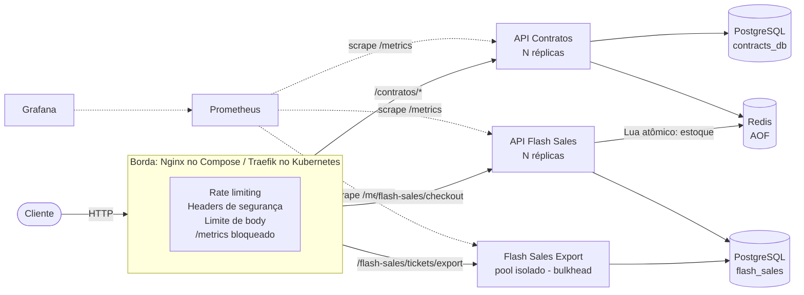
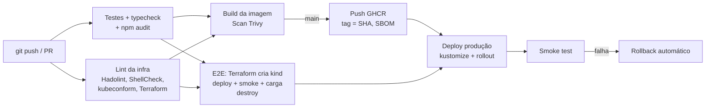

# Forja

> **Forja** é a plataforma DevOps das APIs **Contratos** e **Flash Sales**: o lugar onde o código é
> moldado, testado e entregue em produção de forma automatizada, segura e observável.

A Forja reúne a infraestrutura completa de **implantação, automação e operação** das duas APIs base
fornecidas, construída com práticas de DevOps: containers, Infraestrutura como Código, orquestração com
Kubernetes, CI/CD, observabilidade e segurança desde o início.

> **Nota sobre nomes técnicos:** o nome do projeto é *Forja*. Os identificadores internos (namespace
> `devops-api`, projeto do Compose, cluster kind e imagens `devops-api-*` no GHCR) continuam com o
> prefixo `devops-api` para não quebrar ambientes já provisionados.

| Camada | Tecnologia | Onde fica |
|---|---|---|
| Containerização | Docker (multi-stage, usuário não-root) | `Contratos/Dockerfile`, `Flash Sales/Dockerfile` |
| Ambiente local completo | Docker Compose + Nginx (gateway) | `docker-compose.yml`, `infra/nginx/` |
| Infraestrutura como Código | Terraform (kind + Helm: Traefik, metrics-server) | `infra/terraform/` |
| Orquestração | Kubernetes + Kustomize (base + overlays dev/prod) | `infra/k8s/` |
| CI/CD | GitHub Actions + GHCR + Trivy + Dependabot | `.github/` |
| Observabilidade | Prometheus + Grafana + regras de alerta | `infra/monitoring/`, `infra/k8s/monitoring/` |
| Testes | Jest (unitários), smoke test, k6 (carga/concorrência) | `*/tests/`, `scripts/`, `tests/load/` |
| Automação | Makefile + scripts Bash | `Makefile`, `scripts/` |

### Início rápido

```bash
git clone https://github.com/<seu-usuario>/forja.git
cd forja

cp .env.example .env     # troque as senhas
make up                  # sobe tudo com Docker Compose
make smoke               # valida as APIs de ponta a ponta

make k8s-all             # opcional: cluster Kubernetes local com Terraform + deploy + testes
```

---

## Sumário

1. [Arquitetura](#1-arquitetura)
2. [Estrutura do repositório](#2-estrutura-do-repositório)
3. [Pré-requisitos](#3-pré-requisitos)
4. [Ambiente local com Docker Compose](#4-ambiente-local-com-docker-compose)
5. [Kubernetes provisionado com Terraform](#5-kubernetes-provisionado-com-terraform)
6. [Testando a API](#6-testando-a-api)
7. [Observabilidade](#7-observabilidade)
8. [Testes automatizados e de carga](#8-testes-automatizados-e-de-carga)
9. [Pipeline de CI/CD](#9-pipeline-de-cicd)
10. [Justificativa de arquitetura](#10-justificativa-de-arquitetura)
11. [Ajustes feitos nas APIs](#11-ajustes-feitos-nas-apis)
12. [Resultados da validação](#12-resultados-da-validação)
13. [Solução de problemas](#13-solução-de-problemas)
14. [Limitações e próximos passos](#14-limitações-e-próximos-passos)

---

## 1. Arquitetura

### 1.1 Visão lógica (igual nos dois ambientes)



- **Um banco e um usuário por API** (`contratos_app`, `flash_sales_app`) na mesma instância Postgres:
  isolamento de dados com menor privilégio.
- **Bulkhead**: o endpoint de exportação (que consome muita CPU/memória e bloqueia o event loop de
  propósito) roda em um *pool* separado com a mesma imagem. Um relatório pesado não derruba o checkout.
- **Somente a borda é pública.** Banco, cache, `/metrics` e `/ready` ficam apenas na rede interna.

### 1.2 Fluxo de entrega



---

## 2. Estrutura do repositório

```
.
├── Contratos/                    # API de contratos (código fornecido + ajustes operacionais)
│   ├── Dockerfile                # build multi-stage, runtime Alpine sem npm, usuário 1000
│   ├── src/scripts/migrate.ts    # migração de schema com advisory lock
│   └── src/controllers/HealthController.ts   # /health (liveness) e /ready (readiness)
├── Flash Sales/                  # API de vendas relâmpago (mesma estrutura)
├── docker-compose.yml            # ambiente local completo (11 serviços, 3 redes)
├── .env.example                  # modelo de segredos locais (o .env real não é versionado)
├── Makefile                      # todos os comandos: make help
├── scripts/
│   ├── seed-tickets.sh           # cadastra estoque de ingressos (Compose ou K8s)
│   ├── smoke-test.sh             # teste fim a fim via gateway/ingress
│   └── check-oversell.sh         # confere que não houve venda além do estoque
├── tests/load/                   # testes k6 + Job para rodar dentro do cluster
├── infra/
│   ├── nginx/nginx.conf          # gateway do Compose
│   ├── monitoring/prometheus/    # config do Prometheus (Compose)
│   ├── terraform/                # IaC: cluster kind + Traefik + metrics-server
│   └── k8s/
│       ├── base/                 # manifestos comuns (Deployments, StatefulSets, HPA, PDB,
│       │                         #   NetworkPolicies, Ingress, Middlewares)
│       ├── overlays/dev/         # imagens locais, réplicas mínimas, segredos de dev
│       ├── overlays/prod/        # imagens GHCR, mais réplicas/volumes, segredos via pipeline
│       └── monitoring/           # Prometheus + Grafana + alertas + dashboard (fonte única,
│                                 #   também usada pelo Compose)
└── .github/
    ├── workflows/ci-cd.yml       # pipeline CI/CD
    └── dependabot.yml            # atualização automática de dependências
```

---

## 3. Pré-requisitos

| Ferramenta | Versão testada | Necessária para |
|---|---|---|
| Docker Engine + Compose v2 | 29.x | tudo |
| GNU Make | 4.x | atalhos (opcional, os comandos equivalentes estão no `Makefile`) |
| Node.js | 24.x | rodar testes fora do Docker (opcional) |
| Terraform | ≥ 1.6 (testado com 1.16) | ambiente Kubernetes |
| kubectl | ≥ 1.30 | ambiente Kubernetes |
| kind | ≥ 0.31 | carregar imagens locais no cluster |

> Linters (Hadolint, ShellCheck, kubeconform) e o k6 rodam **via containers**, sem instalação.

---

## 4. Ambiente local com Docker Compose

### 4.1 Passo a passo

```bash
# 1. Crie o arquivo de segredos locais e TROQUE as senhas
cp .env.example .env

# 2. Suba tudo (build das imagens, migrações, APIs, gateway e monitoramento)
make up
#    equivalente sem make:
#    docker compose up -d --build --wait
#    ./scripts/seed-tickets.sh compose show-2026 1000

# 3. Valide o ambiente de ponta a ponta
make smoke
```

O que acontece no `make up`:

1. `postgres` sobe e o script `init-databases.sh` cria os bancos e usuários de cada API.
2. Os serviços *one-shot* `contratos-migrate` e `flash-sales-migrate` aplicam o schema e encerram.
3. As APIs só iniciam depois da migração (`service_completed_successfully`) e do Redis saudável.
4. O `gateway` só sobe quando as três APIs passam no healthcheck.
5. O estoque do evento `show-2026` (1000 ingressos) é cadastrado no Redis.

### 4.2 Endereços

| Serviço | URL | Observação |
|---|---|---|
| Gateway (APIs) | http://localhost:8080 | único ponto público |
| Grafana | http://localhost:3001 | usuário/senha do `.env` |
| Prometheus | http://localhost:9090 | publicado somente em 127.0.0.1 |

### 4.3 Operação do dia a dia

```bash
make ps                                   # status dos containers
make logs                                 # logs de todos os serviços
docker compose up -d --scale flash-sales=4   # escala horizontal (gateway e Prometheus
                                             # descobrem as novas réplicas via DNS)
make down                                 # para (mantém os dados)
make clean                                # para e apaga os volumes
```

---

## 5. Kubernetes provisionado com Terraform

### 5.1 Passo a passo

```bash
# Tudo de uma vez: cluster + imagens + deploy + seed + smoke test
make k8s-all
```

Ou etapa por etapa:

```bash
# 1. Provisionar a plataforma (cluster kind + Traefik + metrics-server)
make k8s-up
#    terraform -chdir=infra/terraform init && terraform -chdir=infra/terraform apply

# 2. Usar o kubeconfig gerado pelo Terraform
export KUBECONFIG=$PWD/infra/terraform/kubeconfig

# 3. Build das imagens e carga no cluster
make k8s-images

# 4. Deploy das aplicações (overlay dev) e do monitoramento
make k8s-deploy
#    kubectl apply -k infra/k8s/overlays/dev
#    kubectl apply -k infra/k8s/monitoring

# 5. Estoque de ingressos + smoke test pelo ingress
make k8s-seed
make k8s-smoke          # usa http://localhost:8081

# 6. Inspecionar
make k8s-status         # pods, HPAs, PDBs, ingress e consumo (kubectl top)
make k8s-grafana        # http://localhost:3002  (admin / dev-grafana)
make k8s-prometheus     # http://localhost:9091

# 7. Destruir tudo
make k8s-down
```

### 5.2 O que é criado

| Recurso | Detalhes |
|---|---|
| Cluster kind | 1 control-plane (Kubernetes v1.35, imagem fixada por digest), porta 8081 do host → ingress |
| Traefik (Helm) | Ingress controller, NodePort 30080, logs de acesso em JSON |
| metrics-server (Helm) | métricas de CPU/memória que alimentam o HPA |
| Namespace `devops-api` | Pod Security Admission `restricted` |
| Deployments | `contratos`, `flash-sales`, `flash-sales-export` (rolling update sem indisponibilidade) |
| StatefulSets | `postgres` e `redis` com volumes persistentes |
| HPA | contratos 1→6 (dev) / 2→6; flash-sales 1→10 (dev) / 3→20 (prod); export 1→4 |
| PDB | ao menos 1 réplica de cada API durante manutenção de nós |
| NetworkPolicies | *default deny*; só o ingress e o Prometheus acessam as APIs; só as APIs acessam o banco/cache |
| Ingress + Middlewares | strip de prefixo, rate limit, limite de body (1 MiB), headers de segurança |
| Namespace `monitoring` | Prometheus (service discovery de pods) + Grafana com dashboard provisionado |

> **Cluster com vários nós:** o padrão é 1 nó porque o kind exige limites de inotify maiores que o
> padrão de muitas distros para adicionar workers. Para 3 nós:
>
> ```bash
> sudo sysctl fs.inotify.max_user_instances=512 fs.inotify.max_user_watches=524288
> terraform -chdir=infra/terraform apply -var worker_count=2
> ```
>
> Os `topologySpreadConstraints` então distribuem as réplicas entre os nós.

---

## 6. Testando a API

As rotas são as mesmas nos dois ambientes; só muda a URL base:

```bash
export BASE_URL=http://localhost:8080   # Docker Compose
# export BASE_URL=http://localhost:8081 # Kubernetes (kind)
```

| Método | Rota pública | Destino | Respostas |
|---|---|---|---|
| GET | `/contratos/health` | API Contratos | 200 |
| POST | `/contratos/contracts` | API Contratos | 201, 400 |
| GET | `/flash-sales/health` | API Flash Sales | 200 |
| POST | `/flash-sales/checkout` | API Flash Sales | 201, 400, 409 (esgotado) |
| POST | `/flash-sales/tickets/export` | pool de export | 200, 429 (rate limit) |
| GET | `/contratos/metrics`, `/flash-sales/metrics` | — | 404 (interno) |

### Contratos

```bash
# Criar contrato (201)
curl -i -X POST "$BASE_URL/contratos/contracts" \
  -H 'Content-Type: application/json' \
  -d '{"title":"Prestação de serviços","userId":"user-42","description":"Contrato anual","value":12000.50}'

# Validação de campos obrigatórios (400)
curl -i -X POST "$BASE_URL/contratos/contracts" \
  -H 'Content-Type: application/json' -d '{"description":"sem título"}'
```

### Flash Sales

```bash
# 1. Cadastrar estoque (a API não tem endpoint administrativo para isso)
./scripts/seed-tickets.sh compose show-2026 1000 --force     # ou: k8s

# 2. Comprar ingressos (201)
curl -i -X POST "$BASE_URL/flash-sales/checkout" \
  -H 'Content-Type: application/json' \
  -d '{"eventId":"show-2026","userId":"user-42","quantity":2}'

# 3. Pedido acima do estoque (409)
curl -i -X POST "$BASE_URL/flash-sales/checkout" \
  -H 'Content-Type: application/json' \
  -d '{"eventId":"show-2026","userId":"user-42","quantity":999999}'

# 4. Relatório pesado (200). Repetindo rápido, o rate limit devolve 429
curl -i -X POST "$BASE_URL/flash-sales/tickets/export" \
  -H 'Content-Type: application/json' -d '{"records":100000}'
```

### Conferindo os dados gravados

```bash
# Docker Compose
docker compose exec postgres psql -U postgres -d contracts_db -c 'SELECT id, title, "userId", value FROM contracts;'
docker compose exec postgres psql -U postgres -d flash_sales  -c 'SELECT "eventId", SUM(quantity) FROM orders GROUP BY 1;'

# Kubernetes
kubectl -n devops-api exec postgres-0 -- psql -U postgres -d flash_sales -c 'SELECT COUNT(*) FROM orders;'
```

---

## 7. Observabilidade

As APIs já expunham métricas Prometheus (`prom-client`). A infraestrutura passou a coletá-las,
visualizá-las e gerar alertas:

- **Coleta**: no Compose, `dns_sd_configs` encontra todas as réplicas de cada serviço. No Kubernetes,
  `kubernetes_sd_configs` encontra os pods anotados com `prometheus.io/scrape: "true"`, inclusive os
  criados pelo HPA. Nos dois ambientes o label `job` recebe o nome da aplicação, então **o mesmo
  dashboard e as mesmas regras de alerta servem para os dois** (arquivos únicos em `infra/k8s/monitoring/`).
- **Dashboard "Forja — Visão geral"** (provisionado automaticamente): instâncias ativas, req/s,
  % de 5xx, respostas por status, latência p50/p95/p99, lag do event loop, CPU e memória por instância.
- **Alertas** (`infra/k8s/monitoring/prometheus/alerts.yml`):

| Alerta | Condição | Severidade |
|---|---|---|
| `ApiInstanceDown` | instância sem responder por 1 min | critical |
| `ApiHighErrorRate` | mais de 5% de respostas 5xx por 5 min | critical |
| `ApiHighLatencyP95` | p95 acima de 1 s por 5 min | warning |
| `NodeEventLoopBlocked` | lag p99 do event loop acima de 0,5 s | warning |
| `ApiHighMemoryUsage` | RSS acima de 450 MiB | warning |
| `FlashSaleSoldOutSpike` | muitos 409 (esgotado) no checkout | info |

- **Logs**: o gateway Nginx e o Traefik registram acessos em JSON, com `X-Request-Id` propagado às
  APIs. No Compose, os logs dos containers têm rotação (10 MB × 3).

---

## 8. Testes automatizados e de carga

| Teste | Comando | O que valida |
|---|---|---|
| Unitários + typecheck | `make test` | regras de negócio, health checks (9 testes) |
| Lint da infraestrutura | `make lint` | Dockerfiles, scripts, Compose, manifestos (schemas, incluindo CRDs), Terraform |
| Smoke test | `make smoke` / `make k8s-smoke` | 10 verificações fim a fim pela borda pública |
| Concorrência / overselling | `make load-test` | pico de até 200 req/s no checkout; vendidos + restante = estoque inicial |
| Bulkhead | `make bulkhead-test` | exports pesados não degradam a latência do checkout |
| HPA no cluster | `make k8s-load-test` + `make k8s-status` | o pool de export escala sob CPU alta |

> Os testes de carga do Compose atingem os serviços **pela rede interna**, sem passar pelo gateway,
> porque um teste vindo de um único IP seria (corretamente) barrado pelo rate limit. O E2E da
> pipeline passa pelo ingress e conta os 429 como resposta esperada.

---

## 9. Pipeline de CI/CD

Arquivo: `.github/workflows/ci-cd.yml`. Todas as actions são fixadas por **SHA de commit**.

| Job | Quando | Etapas |
|---|---|---|
| `test` (matriz por API) | push/PR | `npm ci`, typecheck, testes com cobertura, build, `npm audit` |
| `lint-infra` | push/PR | `make lint` (os mesmos linters do ambiente local) + validação do overlay prod |
| `build-images` (matriz) | após test/lint | build com cache, **scan Trivy** (falha em HIGH/CRITICAL corrigíveis); na `main`: push para o GHCR com tags `SHA`/`latest`, SBOM e proveniência |
| `e2e` | após test/lint | **o mesmo Terraform** cria um cluster kind efêmero, deploy com Kustomize, smoke test, teste de concorrência com verificação de overselling e `terraform destroy` |
| `deploy-production` | push na `main` + `PROD_DEPLOY_ENABLED=true` | segredos gerados a partir dos GitHub Secrets, imagens fixadas no SHA do commit, `kubectl apply -k`, espera do rollout, smoke test e **rollback automático** se algo falhar |

**Para habilitar o deploy em produção**, configure no repositório:

| Tipo | Nome | Conteúdo |
|---|---|---|
| Variable | `PROD_DEPLOY_ENABLED` | `true` |
| Variable | `PROD_BASE_URL` | URL pública do ingress de produção |
| Variable (opcional) | `PROD_SMOKE_EVENT_ID` | evento com estoque reservado para smoke test |
| Secret | `KUBE_CONFIG_B64` | kubeconfig do cluster em base64 |
| Secret | `POSTGRES_PASSWORD`, `CONTRATOS_DB_PASSWORD`, `FLASH_SALES_DB_PASSWORD`, `REDIS_PASSWORD` | senhas de produção |

Em *Settings → Environments → production* dá para exigir aprovação manual antes do deploy.
O **Dependabot** abre PRs semanais com atualizações de npm, imagens Docker, actions e providers do
Terraform, e cada PR passa pela pipeline.

---

## 10. Justificativa de arquitetura

As escolhas abaixo seguem as práticas de DevOps vistas no curso: automação de ponta a ponta,
infraestrutura como código, ambientes reproduzíveis, feedback rápido, segurança desde o início
(*shift-left*) e observabilidade.

### 10.1 Escalabilidade

- **APIs stateless em containers**: todo o estado fica no Postgres/Redis, então qualquer réplica
  atende qualquer requisição e dá para escalar horizontalmente sem afinidade de sessão.
- **HorizontalPodAutoscaler** por CPU, com perfil próprio para cada carga. O `flash-sales` sobe rápido
  (até +100% de pods a cada 15 s) e desce devagar (janela de 5 min), o padrão de picos súbitos de uma
  venda relâmpago. O metrics-server, provisionado pelo Terraform, fornece as métricas.
- **Bulkhead do export**: o relatório pesado tem seu próprio Deployment, HPA, limites e rate limit.
  Os dois pools escalam de forma independente e o export não disputa CPU com o checkout. Validado:
  com exports de até 6,9 s rodando, o checkout manteve p95 abaixo de 6 ms.
- **Concorrência correta sob escala**: a reserva de ingressos usa um script Lua atômico no Redis, então
  várias réplicas podem disputar o mesmo estoque sem overselling. O teste de carga comprova isso:
  500 vendidos de 500, com mais de 8 mil tentativas.
- **Descoberta dinâmica**: o gateway (Nginx com `resolve`), o Prometheus (DNS/K8s service discovery) e
  os Services do Kubernetes passam a usar novas réplicas sem nenhuma reconfiguração manual.

### 10.2 Segurança

- **Imagens mínimas e endurecidas**: build multi-stage. O runtime é Alpine com apenas o binário do Node,
  sem npm/yarn (menos superfície de ataque e menos CVEs), executado como **usuário não-root (UID 1000)**
  com arquivos somente leitura. O Trivy reportou **0 vulnerabilidades HIGH/CRITICAL**.
- **Containers restritos**: `readOnlyRootFilesystem`, `allowPrivilegeEscalation: false`, todas as
  *capabilities* removidas, `seccompProfile: RuntimeDefault`, `automountServiceAccountToken: false` e
  namespaces com **Pod Security Admission `restricted`**. No Compose: `read_only`, `cap_drop: ALL`,
  `no-new-privileges`.
- **Rede zero-trust**: *default deny* com NetworkPolicies no Kubernetes e redes segmentadas no Compose
  (a rede `data` é `internal`). Banco e Redis nunca ficam expostos. O teste com um pod intruso confirmou
  o bloqueio do Postgres, do Redis e das APIs.
- **Borda como única entrada**: rate limiting (geral e um mais rígido para o export), limite de body,
  headers de segurança e bloqueio de `/metrics` e `/ready`. Só as rotas de negócio são roteadas.
- **Menor privilégio nos dados**: um usuário Postgres por API, dono apenas do próprio banco, Redis com
  senha e um RBAC do Prometheus que só permite ler pods.
- **Segredos fora do código**: `.env` e segredos de produção ficam no `.gitignore`. Em produção, a
  pipeline gera os arquivos a partir dos GitHub Secrets e o hash de conteúdo do Kustomize força o
  rollout quando um segredo muda.
- **Cadeia de suprimentos**: actions fixadas por SHA, `npm ci` com lockfile, `npm audit`, scan de
  imagem, SBOM + proveniência no push, imagens de produção imutáveis (tag = SHA do commit) e Dependabot.

### 10.3 Confiabilidade

- **Health checks em três níveis**: `startupProbe` (tempo para subir), `livenessProbe` em `/health`
  (reinicia processo travado) e `readinessProbe` em `/ready`, que testa Postgres e Redis e tira o pod do
  balanceamento quando uma dependência cai. No pool de export os probes são mais tolerantes, já que o
  bloqueio do event loop é esperado ali: sem isso, o pod sairia do Service a cada relatório e o HPA
  ignoraria sua CPU (problema encontrado e corrigido durante a validação).
- **Deploy sem indisponibilidade**: rolling update com `maxUnavailable: 0`, `preStop` de 5 s (espera
  sair dos endpoints) e **graceful shutdown** na aplicação (SIGTERM fecha o servidor HTTP, o pool do
  banco e o Redis). O `tini` repassa sinais corretamente.
- **Migração de schema desacoplada**: `synchronize` desligado nas réplicas. O schema é aplicado por um
  initContainer (K8s) ou serviço one-shot (Compose) com **advisory lock** no Postgres, o que evita a
  condição de corrida de várias réplicas alterando o schema ao mesmo tempo.
- **Persistência**: volumes persistentes para Postgres e Redis. O Redis usa **AOF** porque guarda o
  estoque, que é estado crítico.
- **Disponibilidade em manutenção**: PodDisruptionBudgets e `topologySpreadConstraints` para espalhar
  as réplicas entre nós.
- **Keep-alive ajustado**: `keepAliveTimeout` (65 s) maior que o idle timeout dos proxies, o que elimina
  `connection reset` entre o ingress e o Node (também encontrado e corrigido no teste de carga).
- **Detecção e reação**: alertas de indisponibilidade, erro, latência, event loop e memória. O deploy
  de produção valida com smoke test e faz **rollback automático** se falhar.
- **Reprodutibilidade**: o mesmo Terraform cria o cluster local e o efêmero da pipeline. As versões de
  imagens, charts, providers (`.terraform.lock.hcl`) e dependências (`package-lock.json`) são fixadas.

### 10.4 Por que essas ferramentas

| Decisão | Motivo |
|---|---|
| Docker Compose **e** Kubernetes | Compose para o desenvolvedor subir tudo com um comando; Kubernetes para escala, autorrecuperação e deploys declarativos. Os dois usam as mesmas imagens, o mesmo script de banco, o mesmo dashboard e os mesmos alertas. |
| Kustomize (base + overlays) | Sem templates: YAML puro e legível, diferenças entre ambientes explícitas, suporte nativo no `kubectl`. |
| Terraform para a plataforma | O ciclo de vida da plataforma (cluster, ingress, metrics-server) fica separado do das aplicações (Kustomize), com estado, plano e destruição previsíveis. |
| kind | Kubernetes real e compatível com conformidade rodando em Docker: igual na máquina local e na pipeline, sem custo de nuvem. |
| Traefik | Ingress controller mantido ativamente, com rate limit, headers e strip de prefixo declarativos via CRD (o ingress-nginx foi descontinuado em 2026). |
| Prometheus + Grafana | As APIs já expunham métricas no formato Prometheus, então bastou coletar e visualizar, sem alterar código. |

---

## 11. Ajustes feitos nas APIs

O objetivo foi a infraestrutura, mas alguns ajustes pequenos no código foram **necessários** para operar
as APIs com segurança. A regra de negócio não foi alterada.

| Ajuste | Motivo |
|---|---|
| **Flash Sales:** removido `noUncheckedSideEffectImports` do `tsconfig` e adicionados `experimentalDecorators`/`emitDecoratorMetadata`; `!` nas propriedades da entidade `Order` | O projeto **não compilava** e os testes falhavam (opção inexistente no TypeScript 5.5 e decorators do TypeORM sem suporte). A pipeline detectou o problema. |
| Scripts `build`, `start`, `migrate`, `typecheck`, `test`, `test:ci` e `tsconfig.build.json` | Build de produção (`dist/`) e execução sem `ts-node`. O script `test` original apenas falhava. |
| `GET /health` e `GET /ready` (`HealthController` + testes) | Liveness/readiness para Docker e Kubernetes. |
| `server.ts`: graceful shutdown, `process.exit(1)` em falha de conexão, keep-alive de 65 s | Deploys sem erro, reinício automático pelo orquestrador e fim do ECONNRESET atrás de proxy. |
| `DB_SYNCHRONIZE` + `src/scripts/migrate.ts` | Schema aplicado uma única vez, com lock, antes das réplicas subirem. |
| `REDIS_PASSWORD` opcional em `config/redis.ts` | Redis protegido por senha nos ambientes provisionados. |

---

## 12. Resultados da validação

Todos os itens abaixo foram executados neste ambiente:

| Verificação | Resultado |
|---|---|
| Testes unitários | 9/9 aprovados (4 Contratos, 5 Flash Sales) |
| Smoke test, Docker Compose | 10/10 |
| Smoke test, Kubernetes (via Traefik) | 10/10 |
| Pico de checkout (k6, até 200 req/s) | 8.574 requisições, 0% de erro, p95 = 2,5 ms |
| Overselling | 500 vendidos + 0 restantes = 500 iniciais ✔ |
| Bulkhead (Compose) | exports de até 6,9 s; checkout p95 = 5,7 ms |
| HPA (Kubernetes) | export foi de 1 → 4 réplicas em ~60 s com CPU a 398%; checkout p95 < 3 ms |
| Rate limit do export | `200 200 429 429 429` |
| NetworkPolicy | pod intruso bloqueado no Postgres, no Redis e nas APIs |
| Trivy (HIGH/CRITICAL) | 0 vulnerabilidades nas duas imagens |
| `npm audit` (produção) | 0 vulnerabilidades |
| Lint (Hadolint, ShellCheck, kubeconform, Terraform, actionlint) | sem erros |

---

## 13. Solução de problemas

| Sintoma | Causa provável / solução |
|---|---|
| `defina ... no .env` ao subir o Compose | Rode `cp .env.example .env`. |
| Checkout sempre retorna 409 | Não há estoque para o evento: `./scripts/seed-tickets.sh compose <evento> 1000 --force`. |
| Mudou senhas no `.env` e o Postgres recusa a conexão | O script de init só roda com volume vazio: `make clean && make up`. |
| `terraform apply` falha em `kubeadm join` | Limite de inotify do host; use `worker_count = 0` (padrão) ou aumente os limites (seção 5.2). |
| Pod em `CreateContainerConfigError` | Segredo ausente: confira se aplicou um **overlay** (`infra/k8s/overlays/dev`) e não a `base`. |
| StatefulSet não se recupera depois de corrigir a configuração | Comportamento padrão do Kubernetes: `kubectl -n devops-api delete pod postgres-0`. |
| HPA mostra `<unknown>` | O metrics-server leva cerca de 1 min para ter as primeiras amostras. |
| Porta 8080/8081 em uso | Mude `GATEWAY_PORT` no `.env` ou `-var ingress_http_port=...` no Terraform. |

---

## 14. Limitações e próximos passos

- **Banco gerenciado em produção**: Postgres/Redis em StatefulSet com 1 réplica atendem dev e
  homologação. Em produção o recomendado é um serviço gerenciado (RDS/Cloud SQL, ElastiCache/Memorystore)
  ou um operador (CloudNativePG, Redis Sentinel) com alta disponibilidade e backups.
- **Segredos**: evoluir de GitHub Secrets → arquivo para External Secrets Operator ou Sealed Secrets.
- **TLS**: adicionar cert-manager + Let's Encrypt no Traefik (entrypoint `websecure`).
- **GitOps**: Argo CD/Flux sincronizando `infra/k8s/overlays/prod` no lugar do `kubectl apply` da pipeline.
- **Alertmanager**: rotear os alertas já definidos para Slack/e-mail.
- **Melhorias sugeridas na aplicação**: validar o limite de `records` no export (hoje só limitado pela
  borda e pelo limite de memória), mover o export para uma fila/worker assíncrono e usar migrações
  versionadas do TypeORM no lugar do `synchronize`.
